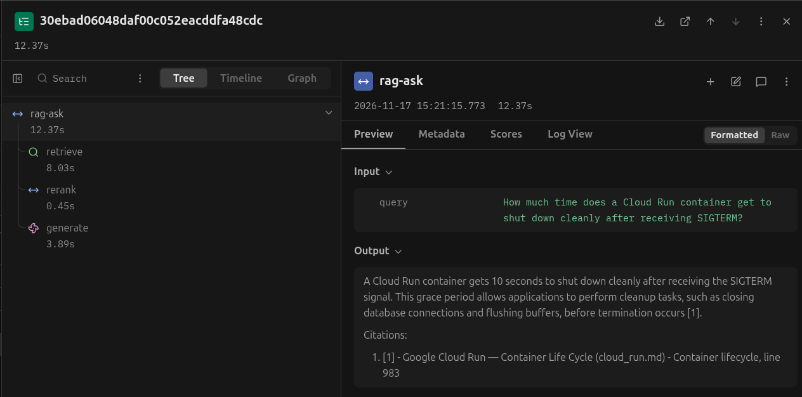
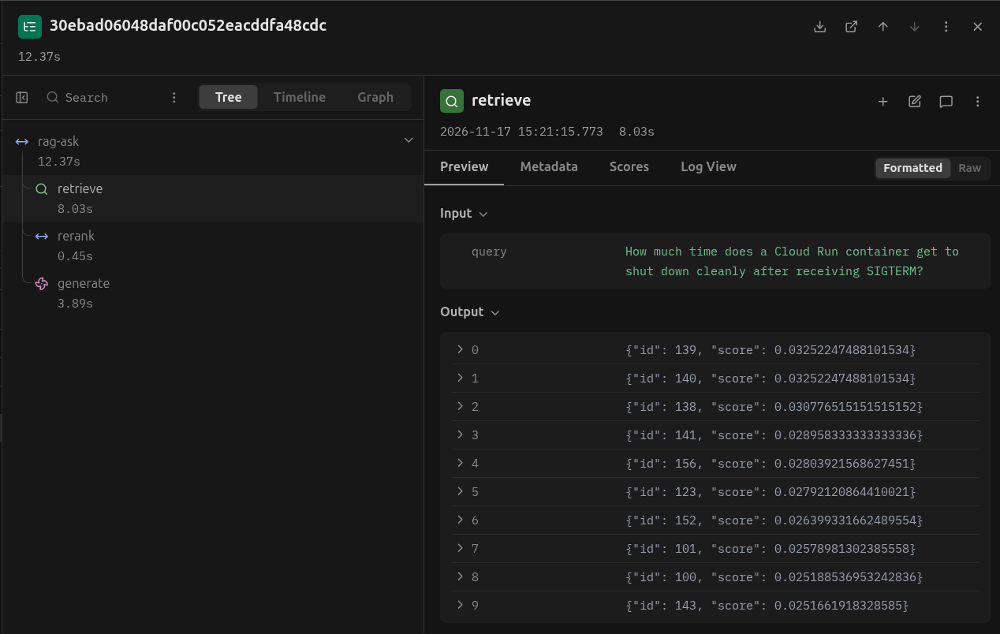
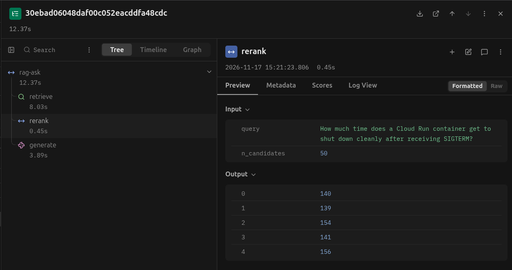
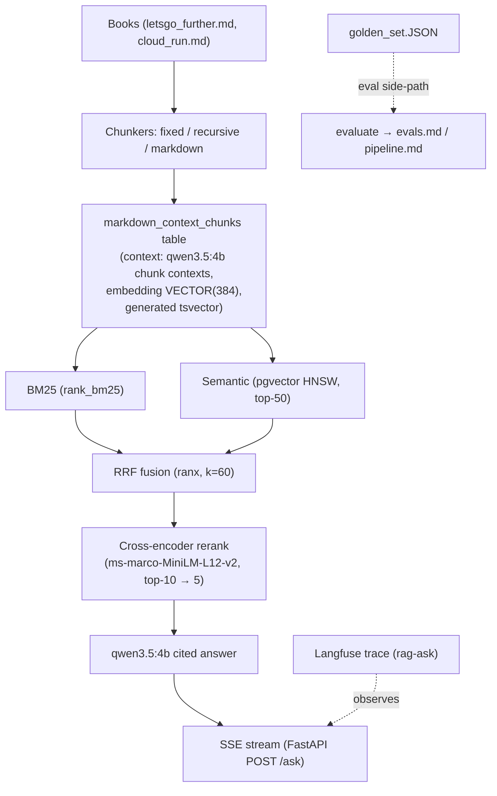

# RAG retrieval pipeline

Retrieval-augmented generation experiments over two ingested books
(_Let's Go Further_, _Google Cloud Run_): chunker variants, retriever
comparisons, contextual retrieval with LLM-generated chunk contexts,
RAGAS-style faithfulness scoring, query-transform variants, and
LangFuse-traced RAG asks.

## Write Up

### Chunkers & retrieval eval

Three chunking strategies (`chunkers.py`):

- **fixed** — 800-char windows, 100-char overlap, snapping window ends to
  newlines when possible.
- **recursive** — split on nested separators (`\n\n`, `\n`, `". "`, `" "`),
  then greedily merge pieces up to 800 chars.
- **markdown** — section-aware chunking: ATX headings build a heading stack;
  sections are split on blank lines and greedily merged up to 800 chars.
  Each chunk carries a heading path plus char/line provenance
  (`MarkdownChunk`: `char_start`/`char_end`/`line_start`), which powers the
  citations in generated answers.

Five retrievers (`retrievers.py`):

- **ts_rank_cd** — Postgres full-text search over a generated `tsvector`
  (GIN index).
- **bm25** — `rank_bm25` BM25Okapi.
- **semantic** — pgvector HNSW cosine search (top-50 candidates) over
  `all-MiniLM-L6-v2` embeddings.
- **rrf** — reciprocal-rank fusion (`ranx`, k=60) of BM25 + semantic
  (top-50 per leg).
- **rrf_ce** — RRF fusion (top-10) → `ms-marco-MiniLM-L12-v2` cross-encoder
  rerank → top-5.

Eval setup: k=5, 50 golden questions, relevance = ground-truth-snippet
containment in chunk content (60-char prefix fallback). Scores are means over
non-skipped questions (a question is skipped when no chunk contains its
snippet; skip counts in the footnote).

Results (`evals.md`, verbatim):

| Retriever  | Chunker   | recall@5 | MRR  | MAP  |
| ---------- | --------- | -------- | ---- | ---- |
| ts_rank_cd | fixed     | 0.55     | 0.36 | 0.36 |
| bm25       | fixed     | 0.83     | 0.68 | 0.68 |
| semantic   | fixed     | 0.89     | 0.66 | 0.66 |
| rrf        | fixed     | 0.89     | 0.66 | 0.66 |
| rrf_ce     | fixed     | 0.91     | 0.83 | 0.83 |
| ts_rank_cd | recursive | 0.52     | 0.29 | 0.29 |
| bm25       | recursive | 0.82     | 0.63 | 0.63 |
| semantic   | recursive | 0.86     | 0.57 | 0.57 |
| rrf        | recursive | 0.88     | 0.66 | 0.66 |
| rrf_ce     | recursive | 0.94     | 0.81 | 0.81 |
| ts_rank_cd | markdown  | 0.60     | 0.35 | 0.35 |
| bm25       | markdown  | 0.88     | 0.68 | 0.68 |
| semantic   | markdown  | 0.86     | 0.62 | 0.62 |
| rrf        | markdown  | 0.92     | 0.68 | 0.68 |
| rrf_ce     | markdown  | 0.92     | 0.81 | 0.81 |

_Skipped (no snippet match): fixed 3, recursive 0, markdown 0_

Query-transform variants (rewrite / multi-query / HyDE vs the rrf_ce
baseline, golden questions 1-10, contextual table):

| Retriever         | recall@5 | MRR  | MAP  |
| ----------------- | -------- | ---- | ---- |
| rrf_ce (baseline) | 1.00     | 1.00 | 1.00 |
| rewrite           | 1.00     | 0.93 | 0.93 |
| multiquery        | 1.00     | 1.00 | 1.00 |
| hyde              | 1.00     | 1.00 | 1.00 |

_NOT comparable to the 50-question averages above — 10-question subset, contextual table only._

### Models

- **LLM** — `qwen3.5:4b` via local [ollama](https://ollama.com): contextual
  chunk contexts, query transforms, RAGAS judge, grounded/cited answers.
- **Embeddings** — `sentence-transformers/all-MiniLM-L6-v2` (384-dim,
  stored as Postgres `VECTOR(384)`, HNSW index).
- **Cross-encoder** — `cross-encoder/ms-marco-MiniLM-L12-v2` (BERT,
  512 max tokens, ~127MB).

### Query parsing / contextual retrieval

Contextual retrieval follows the [Anthropic recipe](https://www.anthropic.com/news/contextual-retrieval)
(`pipeline.py`): before indexing, each chunk is sent to `qwen3.5:4b` together
with the whole document, and the LLM generates a short succinct context
situating the chunk within the document (temperature 0, ≤128 output tokens,
1 worker, batch-32 commits). Contexts are cached in the
`markdown_context_chunks` table and never dropped — the first run pays the
generation cost, subsequent runs are fast.

The context is prepended to the chunk for all retrieval legs (SQL
`BODY_EXPR`: `coalesce(context, '') || E'\n' || content`) — BM25 corpus,
embeddings, and cross-encoder passages. The original chunk text stays in
`content`, so snippet-containment relevance is unaffected.

LLM query transforms (`variants.py`), all via local `qwen3.5:4b` at
temperature 0:

- **rewrite** — LLM-rewritten query feeds the entire base rrf_ce retriever.
- **multiquery** — original + 3 LLM variants each through the RRF leg
  (top-10); union candidates; cross-encoder rerank anchored on the
  ORIGINAL question.
- **HyDE** — hypothetical document embedding replaces the query embedding
  in the semantic leg only; BM25 and cross-encoder keep the original
  question.

### Metrics

`scorers.py`: **recall@5** (fraction of relevant ids in the top 5),
**MRR** (reciprocal rank of the first relevant id in the top 5), and
**MAP** (mean of precision@i over relevant positions in the top 5,
normalized by |relevant|). Means over non-skipped golden questions;
relevance = ground-truth-snippet containment with a 60-char prefix
fallback (`eval.py`).

RAGAS-style faithfulness (`ragas.py`): 5 hard-coded questions through the
contextual-retrieval pipeline → grounded answers → statement extraction →
each statement verified against the same context → F = supported/total.
Reference-free, `qwen3.5:4b` as judge.

Pipeline result (`pipeline.md`): contextual retrieval + rrf_ce scores
recall@5 / MRR / MAP all **1.00** — CAVEAT: evaluated on an 11/50-question
subset (Google Cloud Run chunks 0-249; 39 questions skipped because their
snippet matches no subset chunk). Not comparable to the 50-question table
above.

### Best pipeline setup and why

Best full-corpus setup: **rrf_ce + recursive chunker** (recall@5 0.94,
MRR/MAP 0.81), with markdown close behind (0.92 / 0.81). Contextual
retrieval (`markdown_context_chunks` + rrf_ce) scores 1.00 on its
11-question subset.

Why it wins:

- **RRF fusion** fixes the rank disagreement between BM25 and semantic
  retrieval — each leg alone misses what the other finds (semantic 0.86-0.89
  recall vs rrf 0.88-0.92 across chunkers).
- **Cross-encoder rerank is the single biggest MRR jump** (fixed chunker:
  0.66 → 0.83; 0.81 across chunkers) because it scores query and passage
  jointly instead of relying on a lexical or embedding proxy.
- **Contextual retrieval** situates each chunk in its document, so both the
  BM25 corpus and the embeddings match question intent better than raw
  chunk text.
- **Query transforms added nothing** over the already-strong baseline
  (1.00 baseline vs 0.93-1.00 variants on the 10-question subset) — the
  cross-encoder already handles wording variation well enough that rewrite/
  multiquery/HyDE have no headroom here.

### Tracing with LangFuse + streaming

`traces.py` builds an `@observe`-decorated chain — root trace `rag-ask`
→ `retrieve` (retriever observation) → `rerank` (span) → `generate`
(generation, with `usage_details` from ollama token counts) — and posts it
to the self-hosted LangFuse server (`localhost:3000`) via the Langfuse SDK.
`main.py serve` exposes `POST /ask` as an SSE stream (status → token
deltas → done): sync retrieve/rerank run in a threadpool off the event
loop; time-to-first-token is captured via `completion_start_time` on the
first token; client disconnects and errors are recorded on the trace
(WARNING/ERROR levels) before re-raising.

Example traces from the LangFuse UI:

## Documentation

### Exploratory project

This is a learning project, not a production or practical RAG system: the
stack is local-only (Postgres with default local credentials, ollama on
localhost, self-hosted LangFuse), the corpus is just two books, relevance in
the eval is a snippet-containment proxy rather than human judgments, the
RAGAS questions are hard-coded, and the eval harness is exploratory. It was
built to learn and compare RAG techniques — chunking, hybrid retrieval,
fusion, rerank, contextual retrieval, query transforms — not to deploy.

### Technologies used

Python 3.12 + [uv](https://docs.astral.sh/uv/); [typer](https://typer.tiangolo.com) CLI;
[fastapi](https://fastapi.tiangolo.com) + uvicorn (SSE streaming);
psycopg3 + [pgvector](https://github.com/pgvector/pgvector) (HNSW) +
tsvector/GIN (Postgres); [rank-bm25](https://github.com/dorianbrown/rank_bm25);
[ranx](https://github.com/AmenRa/ranx) (RRF fusion);
[sentence-transformers](https://sbert.net) (embeddings + cross-encoder);
[ollama](https://ollama.com) (`qwen3.5:4b`);
[langfuse](https://langfuse.com) SDK (tracing); numpy; python-dotenv.

### Commands

All commands run through the Typer CLI in `main.py`.

#### `uv run main.py setup`

Create the 3 chunker tables (fixed, recursive, markdown), ingest both
books, build GIN/HNSW indexes. Run once before `eval`.

#### `uv run main.py eval`

Compare 5 retrievers (ts_rank_cd, BM25, semantic, RRF, RRF+cross-encoder)
across chunkers against the golden set; writes the 15-row `evals.md`.

#### `uv run main.py pipeline`

Evaluate the contextual-retrieval pipeline (markdown + qwen3.5:4b contexts

- BM25 + semantic + RRF + cross-encoder rerank). Builds
  `markdown_context_chunks` idempotently (contexts are LLM output, cached in
  the DB — the first run pays the generation cost, subsequent runs are fast);
  writes `pipeline.md`.

#### `uv run main.py ragas`

RAGAS-style faithfulness: 5 hard-coded questions through the
contextual-retrieval pipeline (qwen3.5:4b answers grounded in top-5
retrieved chunks); statements verified against the same context; prints
per-question scores and their mean.

#### `uv run main.py variants`

Query-transform retrieval eval over the pipeline table
(`markdown_context_chunks`, golden questions 1-10): rewrite / multi-query /
HyDE vs the rrf_ce baseline. LLM transforms via local qwen3.5:4b (temp 0,
recomputed each run); appends the `## Query variants` section to `evals.md`.

#### `uv run main.py trace "<question>"`

One LangFuse-observed RAG ask: markdown_context_chunks + RRF retrieve +
cross-encoder rerank + qwen3.5:4b grounded answer. Prints the answer and
posts a single `rag-ask` trace to the LangFuse server (`localhost:3000`),
with retriever / span / generation observations and token usage. Inspect
the trace in the LangFuse UI under Traces.

#### `uv run main.py serve`

FastAPI server: `POST /ask` streams a cited RAG answer as SSE tokens
(`127.0.0.1:8000`).

### Prerequisites

- [uv](https://docs.astral.sh/uv/) (Python 3.12, deps in `pyproject.toml`)
- Postgres with a `p2` database (pgvector extension; see `setup.py`)
- `ollama serve` with the `qwen3.5:4b` model pulled
- LangFuse Docker stack on `localhost:3000` (only needed for `trace`)
- `.env` with `LANGFUSE_PUBLIC_KEY`, `LANGFUSE_SECRET_KEY`,
  `LANGFUSE_BASE_URL` (only needed for `trace`)

### Architecture

Eval side-path: `golden_set.JSON` → `evaluate` (`eval.py`) → `evals.md` /
`pipeline.md`; RAGAS faithfulness uses the same retrieval stack with
`ragas.py` as judge harness.
